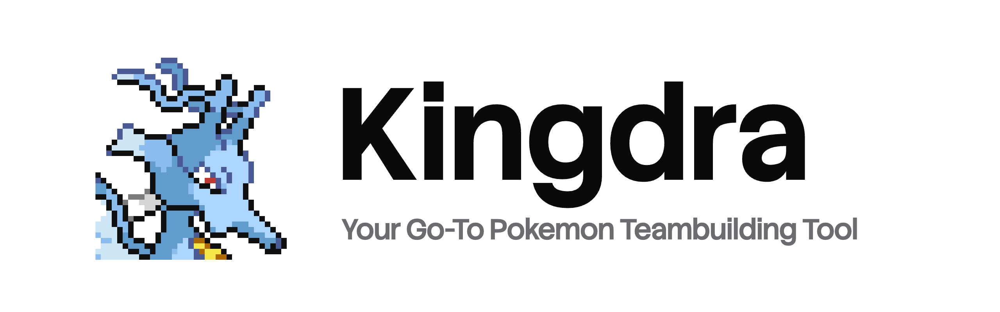

<picture>
  <source media="(prefers-color-scheme: dark)" srcset="public/banner-dark.png">
  
</picture>

# Kingdra

<p align="center">
  <a href="https://pokedraft.liambsullivan.com"></a>
  <a href="#install-as-an-app"></a>
  <a href="https://www.figma.com/design/H8XygLsOxYDmwr881Cxct5"></a>
</p>
<p align="center">
  <a href="https://nextjs.org"></a>
  <a href="https://react.dev"></a>
  <a href=".nvmrc"></a>
  <a href="#legality-checks"></a>
  <a href="tests/README.md"></a>
  <a href="https://github.com/liambsulliva/kingdra-teambuilder/stargazers"></a>
</p>

A Pokémon teambuilder for casual and competitive teams. Plan a team for a playthrough or for a Smogon ladder in the same app, and switch a team between the two modes without losing its sets.

I started it as a small builder for a Pokémon draft league with friends. Most teambuilders I tried either couldn't set moves and stats or were built only for Showdown players. Kingdra does both.

> [!IMPORTANT]
> As a guest, your teams live in this browser's local storage, and clearing site data deletes them. Sign in to save them to your account. On sign-in, Kingdra adds your local teams to the account and overwrites nothing.

[Open Kingdra](https://pokedraft.liambsullivan.com)

---

## What it does

**Casual and competitive teams side by side.**
Each team has its own mode, generation and format. A casual team edits species, ability, item and moves, and adds Pokédex and encounter location views. A competitive team edits every field Showdown stores: level, nature, EVs and IVs, Tera type, Dynamax level and Gigantamax, Hidden Power type, happiness, Poké Ball, gender and shiny. Switching a team's mode hides fields but keeps their values.

**Formats for every generation.**

- Smogon singles: Ubers, OU, UU, RU, NU, PU, ZU and LC (Gen 1 and 2 have fewer tiers)
- Doubles OU, from Gen 3
- VGC 2013, 2016, 2019, 2022 and 2025, one per generation from Gen 5
- National Dex, in Gen 8 and 9
- Pokémon Champions, in Gen 9 (see [Pokémon Champions](#pokémon-champions))

The format picks the suggestion tiers and the legality rules.

<a id="legality-checks"></a>
**Legality checks from Pokémon Showdown.**
`/api/validate` runs Showdown's own `TeamValidator` for the team's format and attaches each problem to its member. A warning icon sits next to the field, with the reason in a tooltip. Flags never block editing or export. Four kinds of problem have a one-click fix: no EVs, no moves, a move the species can't learn, and an invalid or banned item.

**Suggestions from Smogon data.**
The bottom panel lists Pokémon from the team's tier and the tiers below it, sorted by base stat total and loaded 60 at a time. Search covers the whole catalogue, not only the loaded cards. Competitive teams can filter by role: wallbreaker, pivot, revenge killer, lead, setup sweeper, wall, hazard setter, hazard removal, support and Trick Room. The roles come from Smogon set names, so treat them as rough labels. On the card, "Load Smogon Set" offers Smogon's sets for that species and format.

**Stats with the game's formulas.**
Six color-coded bars show base and final stats, with EV and IV sliders and inputs, nature markers, a 510 EV budget (508 is the efficient cap) and Speed tiers at +1, +2 and +3 in a tooltip. Gen 1 and 2 teams get DVs and a shared Special stat. Double-click a stat to reset it.

**Lossless Showdown import and export.**
Paste Showdown text to create a new team, or paste one set onto the card to replace that member. Copy a team or a set back out the same way. Level, nickname, gender, IVs and every other field survive the round trip, and the test suite checks that on 275 sets.

**Drag and drop.**
Drag a suggestion onto the party or the card. Reorder the party, drag a member to another team (an occupied slot swaps), drop it in the Box, or release it anywhere else to remove it. Touch screens drag after a long press, and dnd-kit's keyboard sensor covers the keyboard.

**A shared PC Box.**
Every team shares one Box of up to 32 boxes with 30 slots each, as in the games. Stored Pokémon keep their full sets. A Pokémon moved into a team of another generation or format keeps its set, and Kingdra flags anything that is no longer legal.

**Team analysis and matchups.**
The team view counts offensive coverage and defensive weaknesses across all 18 types, immunities included. Click a type badge to see one member's ×4, ×2, ×½, ×¼ and ×0 matchups.

**Evolution lines.**
The card shows the whole line, branches included. Click another stage to change species. The set stays, and anything the new species can't use is flagged.

**A layout for each screen size.**

- Desktop: team list, card, inspector and suggestions on one screen.
- 651 to 1100 px: the card becomes the inspector's first tab.
- 650 px and below: a bottom tab bar switches between Teams, Party and Browse. Editors open as sheets, and a long press on a party member opens its actions.

**Themes, sprites and motion.**
The header switches between light and dark themes and between two card sprite sets: Black/White animated sprites or Showdown's X/Y-style 3D models. "Enable fancy animations" turns off the large motion: the team-switch walk, the card-view fall and shatter, the jump onto the card and the card hinge. With the system's reduced-motion setting on, most motion becomes a short fade (see [Known issues](#known-issues)).

**Autosave.**
Guests save to `localStorage`. Signed-in users save to MongoDB, authenticated with Clerk. The header shows "Saved in this browser", "Saved" or "Not saved", and Kingdra reports a failed save instead of dropping it.

## Requirements

To use Kingdra, you need a current desktop or mobile browser and an internet connection.

To run it yourself, you need:

- Node.js 24 (pinned in `.nvmrc` and `package.json`)
- npm
- A MongoDB database, for account saves
- A Clerk application, for sign-in

## Install as an app

Kingdra is an installable PWA. [`src/app/manifest.ts`](src/app/manifest.ts) declares a standalone app with 192 px, 512 px and maskable icons cut from the header logo.

- **Chrome or Edge on desktop:** click the install icon in the address bar.
- **Chrome on Android:** open the menu and choose Install app.
- **Safari on iPhone or iPad:** tap Share, then Add to Home Screen.

> [!NOTE]
> Kingdra has no service worker and doesn't work offline, so the installed app still loads from the server. An earlier cache-first worker served stale HTML to returning visitors. [`public/sw.js`](public/sw.js) now clears its caches and unregisters itself, and the root layout removes any registration that's left.

## Pokémon Champions

Gen 9 teams can use four Pokémon Champions formats: Champions OU, Champions UU, Champions BSS and Champions VGC 2026. They play at level 50 with Stat Points (32 per stat, 66 in total) instead of EVs and IVs, and without Tera.

The `@pkmn` packages don't include the Champions mod yet. Validation uses upstream `pokemon-showdown` instead, and [`scripts/build-champions-data.mjs`](scripts/build-champions-data.mjs) copies its legal species, tiers, items (Mega Stones included) and learnsets into `src/lib/data`. Run it again after you update `pokemon-showdown`.

## Draft mode

> [!NOTE]
> Draft mode is experimental.

Draft mode connects a team to your league's draft board in Google Sheets. Build the board from Smogon's [Draft League Planning Template](https://www.smogon.com/forums/threads/draft-league-resources.3716128/): make a copy, fill in your league's Pokémon and picks, then open Share and set General access to Anyone with the link. Paste the sheet's link into Kingdra.

Kingdra reads the sheet live. Suggestions follow the board, and a Pokémon another coach has taken can't be added to your team.

## Design

The design lives in the [Kingdra Swiss redesign Figma file](https://www.figma.com/design/H8XygLsOxYDmwr881Cxct5). It holds the components, the desktop and phone screens in light and dark, and motion storyboards with timings.

[`docs/redesign/spec.md`](docs/redesign/spec.md) records the layout, interaction and motion decisions. Where the spec and the tests disagree, the tests win.

The type is Stack Sans Text for the interface, Stack Sans Headline for the wordmark and Pokémon names, and IBM Plex Mono for dex numbers only. Hairlines are the only dividers. The chrome is monochrome with one blue accent, and red is reserved for errors and destructive actions.

## Running locally

Install dependencies:

```bash
npm install
```

Create `.env.local` with your keys:

```
NEXT_PUBLIC_CLERK_PUBLISHABLE_KEY=
CLERK_SECRET_KEY=
MONGODB_URI=
```

Start the dev server on http://localhost:3000:

```bash
npm run dev
```

| Command                      | What it does                                                                                        |
| ---------------------------- | --------------------------------------------------------------------------------------------------- |
| `npm run dev`                | Starts the dev server                                                                               |
| `npm run build`              | Lints, runs the full test suite, then runs `next build`. A failing test fails the build.            |
| `npm run start`              | Serves the production build                                                                         |
| `npm run lint`               | Runs ESLint                                                                                         |
| `npm test`                   | Runs the unit and simple tests in watch mode                                                        |
| `npm run test:simple`        | Runs the unit and simple tests once (about 2 s)                                                     |
| `npm run test:comprehensive` | Runs every test, including the stress suite over 32 seeded teams and 100 boxed Pokémon (about 15 s) |

The comprehensive suite prints its seed. Replay a run with `STRESS_SEED=<n> npm run test:comprehensive`. [`tests/README.md`](tests/README.md) lists every flow the tests pin.

Two scripts regenerate bundled data:

- [`scripts/build-sprite-data.mjs`](scripts/build-sprite-data.mjs) precomputes icon bounding boxes and PokeAPI form IDs into `src/lib/data/sprite-data.json`, so the browser never measures images.
- [`scripts/build-champions-data.mjs`](scripts/build-champions-data.mjs) regenerates the Champions data.

Production runs on Vercel. With a live Clerk key, [`src/proxy.ts`](src/proxy.ts) forwards Clerk's Frontend API through `/__clerk`. Startup timings and the rules that keep edits fast are in [`docs/performance.md`](docs/performance.md).

## FAQ

**Is this Pokémon Showdown?**
No. Kingdra builds teams and doesn't battle. It uses Showdown's validator and text format, so you can copy a team from one into the other.

**Where are my teams saved?**
Guest teams are in this browser's `localStorage`. Signed-in teams are in MongoDB. Signing in adds your guest teams to your account.

**Does it work offline?**
No. Kingdra needs a connection for sprites, Smogon data and validation, so it ships no offline cache.

**Why is my set flagged?**
Showdown's validator found a problem for the team's format. Hover the warning icon for the reason. Flags never block editing or export, and some come with a Fix button.

**Why didn't evolving or moving a Pokémon remove its illegal moves?**
Kingdra flags problems instead of deleting your work, so you choose what to change.

**Can a team have duplicate species?**
Yes, unless the format's Species Clause forbids it. Then Kingdra flags the duplicate.

## Known issues

The test suite pins each of these with `it.fails`, so the test starts failing once the bug is fixed.

- On a phone, picking a move for a tapped move slot leaves the editor sheet open.
- Between 626 and 650 px wide, the phone layout picks up some desktop styles: the card sprite box, gutters and team button size.
- Reduced motion doesn't reach the stat bars. Switching Pokémon still runs the bars' overshoot, and the numbers still count up.
- `PUT /api/library` with a `null` body and `POST /api/validate` with a body that isn't JSON, or with a member that has no moves, throw instead of answering 400.

## AI usage

I used AI coding tools in the build of this project. Every change has been checked against an Opus-generated test suite, which pins each user flow and fails the production build when one breaks.

## Credits

- **[Pokémon Showdown](https://github.com/smogon/pokemon-showdown)** runs the legality checks and supplies the Champions data.
- **[@pkmn](https://github.com/pkmn/ps)** (`@pkmn/dex`, `@pkmn/data`, `@pkmn/sets`, `@pkmn/img`) supplies species, learnsets, items, abilities, natures, tiers and Showdown text parsing.
- **[Smogon](https://www.smogon.com)** sets and usage stats, through the [pkmn mirror](https://github.com/pkmn/smogon), power the suggestions, roles and "Load Smogon Set".
- **[PokeAPI](https://pokeapi.co)** supplies the icons, card sprites, Pokédex entries and encounter locations.
- **[Majesticons](https://github.com/halfmage/majesticons)** draws every interface icon.
- **[Stack Sans](https://fonts.google.com/specimen/Stack+Sans+Text)** and **[IBM Plex Mono](https://fonts.google.com/specimen/IBM+Plex+Mono)** set the type.
- **[Clerk](https://clerk.com)**, **[MongoDB](https://www.mongodb.com)**, **[Motion](https://motion.dev)**, **[dnd-kit](https://dndkit.com)** and **[Zustand](https://zustand.docs.pmnd.rs)** handle sign-in, storage, animation, drag and drop, and state.

## Legal

Kingdra is not affiliated with, endorsed by, or associated with Nintendo, Game Freak, Creatures Inc. or The Pokémon Company. Pokémon and Pokémon character names are trademarks of Nintendo.
